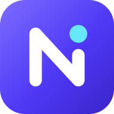

<p align="center">
  
</p>

<h1 align="center">NexaCRM</h1>

<p align="center">
  <strong>The AI-powered CRM for small sales teams.</strong><br>
  Contacts, companies, leads and deals · drag-and-drop sales pipeline · tasks and activity tracking · sales reports · AI sales assistant
</p>

---

NexaCRM is a full-stack **customer relationship management (CRM)** web app for small sales teams: contacts, companies, leads, deals, a Kanban sales pipeline,
activities, tasks, notes, notifications, reports, an audit log, and an **AI assistant** that turns plain-language
notes about your sales work into CRM records. Several teams can share one installation: each **organization** has
its own, fully separate data. It's inspired by the core of HubSpot and kept simple enough to understand end to end.

**Live:** frontend on Vercel at [nexa-crm-eta.vercel.app](https://nexa-crm-eta.vercel.app), API on Render
(see [Deployment](#deployment)).

**Stack:** Next.js 16 · TypeScript · Tailwind CSS · shadcn/ui · TanStack Query · FastAPI · SQLAlchemy 2 ·
Alembic · PostgreSQL · Supabase Auth · LangGraph + LangChain (Google Gemini or a local Ollama model) · Docker Compose

---

## Features

| Area | What you can do |
|---|---|
| **Dashboard** | KPI tiles (contacts, companies, leads, active/won/lost deals, pipeline & weighted value, win rate, lead conversion), pipeline-by-stage and monthly revenue charts, recent activity, your upcoming tasks, lead sources |
| **Contacts** | CRUD, search (name/email/phone/title), filter by status/tag/owner, sort, paginate, tags, company link, activity timeline, deals, tasks, notes |
| **Companies** | CRUD, industry/owner filters, contact & deal counts, open pipeline value, company-wide timeline (includes its contacts' activity) |
| **Leads** | CRUD, status & source tracking, 0–100 lead score, **one-click conversion → Contact + Company + Deal** (matches an existing company by name, carries the lead's history over) |
| **Social lead import** | Bring leads in from **Facebook & Instagram** lead ads (Meta Lead Ads: real-time webhook + “Sync now”), **X, LinkedIn, TikTok, YouTube, WhatsApp** and anything else through a secret webhook URL (Zapier/Make/n8n), or a **CSV/TSV export** (Leads → Import, with preview). Leads are tagged with their platform and handle, de-duplicated by email and platform lead id, assigned to a chosen owner, and extra form answers are saved as a note |
| **Deals** | CRUD, list view with filters, clickable stage path, probability & weighted value, won/lost tracking |
| **Pipeline** | **Kanban board** with drag-and-drop between stages (optimistic updates) plus a "Move to" menu for touch devices |
| **Activities** | Log calls, meetings and emails against contacts, companies, leads and deals; chronological feed with type/owner/date filters |
| **Tasks** | Due dates, priorities, statuses, assignees, links to records; My tasks / Team, Open / Overdue / Completed views |
| **Notes** | On any contact, company, lead or deal; editable by the author |
| **Reports** | Lead conversion, sales pipeline, revenue by month, won vs lost, sales-rep performance, lead source performance — all with date filtering |
| **Notifications** | In-app: lead/deal/task assigned to you, task due, deal won/lost. Bell with unread count |
| **Audit log** | Who created, changed (field-level diff), converted, moved or deleted what, and when |
| **AI assistant** | "AI Assistant" button in the top bar opens a chat panel. Describe calls, cold emails, meetings, new prospects and follow-ups in your own words; the assistant searches for existing records first (no duplicates), then creates or updates leads, contacts, companies, activities, notes and tasks, and links to everything it saved. Ask it questions ("what's Vikram's number?", "all qualified leads from the website") and it answers from the CRM, then offers the list or write-up as an **Excel, Word, PowerPoint or Markdown** file. **Voice input**: speak instead of typing; open-source Whisper transcribes on the API server. It uses the same permissions, validation, audit trail and notifications as the UI |
| **Organizations** | Create an organization (you become its Admin), invite teammates by email with a role, switch between organizations from the sidebar. Data, notifications and roles are per organization |
| **Auth & roles** | Supabase sign-up, login, email verification, password reset. Roles per organization: Admin, Manager, Sales Rep |
| **Look & feel** | Light, dark and system themes; responsive layout; public landing page with SEO metadata |

### Roles

| | Admin | Manager | Sales Rep |
|---|:-:|:-:|:-:|
| View all of the organization's records | ✅ | ✅ | ✅ |
| Create records (in the UI or through the AI assistant) | ✅ | ✅ | ✅ (owned by themselves) |
| Edit records | any | any | only their own |
| Reassign owner, delete records | ✅ | ✅ | ❌ (can delete their own activities, notes and tasks) |
| Rep performance report, audit log | ✅ | ✅ | ❌ |
| Invite/manage members, rename the organization, pipeline stages, lead sources | ✅ | ❌ | ❌ |

**Organizations.** All data belongs to an organization, and members only ever see their own organization's records.
Signing up gives access to nothing: a new user either creates an organization (and becomes its Admin) or is invited
by an Admin of an existing one (Settings → Users & roles → Invite people) and accepts the invitation after signing in
with that email. Invitations aren't emailed; they appear on the person's **Your organizations** page and last 14 days.
Roles are per organization, so someone can be Admin in one and Sales Rep in another. Every organization keeps at
least one active Admin, and Admins can't demote, disable or remove themselves.

---

## Architecture

```
 Browser ──(login, signup, reset)──▶ Supabase Auth ──▶ issues JWT
    │
    │  REST + Authorization: Bearer <JWT> + X-Organization-Id
    ▼
 Next.js (App Router) ──Axios──▶ FastAPI ──SQLAlchemy──▶ PostgreSQL
  - proxy.ts refreshes the        - verifies the JWT (JWKS or HS256)
    session, guards routes        - loads/creates the user's profile
  - TanStack Query cache          - checks the membership → role; scopes the DB session
  - active organization in          to that organization
    localStorage                  - routes → services → models
                                  - audit log + notifications in the same transaction
                                  - /api/assistant/chat ──▶ LangGraph agent ──▶ Gemini API or local Ollama
```

- **Supabase is only the identity provider.** All CRM data lives in our PostgreSQL, owned by SQLAlchemy/Alembic.
  FastAPI never sees passwords; it verifies Supabase-signed tokens and keeps an app-side `profiles` table, with roles
  on `memberships` (one per user and organization).
- **Multi-tenancy on the database session.** Every CRM table has an `organization_id`. `app/db/tenancy.py` adds
  `WHERE organization_id = …` to every query and stamps new rows, for the organization in the request's
  `X-Organization-Id` header (after checking the user is an active member). With no organization selected, queries
  return nothing, so a forgotten filter can't leak data.
- **Synchronous SQLAlchemy** keeps the code simple to read and debug. FastAPI runs sync endpoints in a thread pool.
- **No background workers.** Task-due notifications are created lazily when a user loads notifications; the bell polls every 60s.
- **Server-side search, filtering, sorting and pagination** for every list; sort columns are whitelisted.
- **The AI assistant is a LangGraph agent** (`backend/app/services/assistant/`). The model loops "think → call tools →
  read results" until it answers in plain text. Its LangChain tools call the same route functions as the REST API, so a record
  created by chat is validated, permission-checked, audited and notified exactly like one created in the UI. The
  server keeps no chat state: the browser sends the whole conversation with every message. The model is chosen in
  `backend/.env`: `LLM_PROVIDER=gemini` (Google Gemini, with an automatic fallback model when the main one is
  overloaded or out of quota) or `LLM_PROVIDER=ollama` (a local model such as `qwen3:4b`).

More detail (schema, ER diagram, design decisions): [docs/ARCHITECTURE.md](docs/ARCHITECTURE.md).

### Project structure

```
nexa-crm/
├── docker-compose.yml        # postgres + backend + frontend (optional); reads a root .env you create
├── docker/postgres/init.sql  # creates the nexa_crm_test database
├── docs/                     # ARCHITECTURE.md, USER_GUIDE.md and the context files (purpose, ai, tech-stack,
│                             # design, rules, production, cloud, contributing)
├── backend/
│   ├── app/
│   │   ├── main.py           # app factory, CORS, error handlers
│   │   ├── core/             # settings, JWT verification, HTTP errors
│   │   ├── db/               # engine/session, declarative base, tenancy.py (organization scoping)
│   │   ├── models/           # SQLAlchemy models
│   │   ├── schemas/          # Pydantic request/response models
│   │   ├── services/         # business logic: permissions, lead conversion, lead import, Meta leads, deals,
│   │   │                     # reports, audit, notifications
│   │   │   └── assistant/    # AI assistant: agent.py (LangGraph), tools.py (LangChain tools), llm.py (Gemini/Ollama),
│   │   │                     # records.py (list filters), exports.py (Excel/Word/PowerPoint/Markdown), speech.py (Whisper)
│   │   ├── api/routes/       # one router per feature (incl. organizations.py, integrations.py)
│   │   ├── dependencies/     # auth (signed-in user, organization member, roles), pagination
│   │   └── utils/            # search / sort / paginate helpers
│   ├── alembic/              # migrations
│   ├── scripts/seed.py       # demo data in a separate "Demo Organization" (--reset, --clear)
│   └── tests/                # pytest suite
└── frontend/src/
    ├── app/                  # routes: landing page, (auth) pages, (app) pages, organizations, auth/callback,
    │                         # robots / sitemap / manifest / Open Graph image
    ├── proxy.ts              # Next.js 16 "middleware": session refresh + redirects
    ├── components/ui/        # shadcn/ui primitives
    ├── components/shared/    # DataTable, Pagination, filters, KanbanBoard, ActivityTimeline, BarChart, dialogs…
    ├── features/<module>/    # module views, forms and TanStack Query hooks (incl. assistant/ chat panel,
    │                         # organizations/ gate + switcher + picker, integrations/ lead sources)
    ├── services/             # typed Axios API calls
    ├── hooks/ lib/ types/ utils/
```

---

## Database

| Table | Purpose |
|---|---|
| `profiles` | App users (id = Supabase user id), name, email, account-wide active flag. No role |
| `organizations` | Tenants: name, creator |
| `memberships` | A user's access to one organization: role (admin / manager / sales_rep) and status (active / disabled) |
| `invitations` | Pending offers of a role to an email address; expire after 14 days |
| `companies` | Accounts |
| `contacts` | People; optional company; `tags text[]` |
| `leads` | Prospects; source, status, score; `converted_*_id` after conversion; social platform, handle and external id for imported leads |
| `lead_integrations` | Lead sources: secret webhook URL or a Meta Page connection (encrypted token), default owner and score, import stats |
| `pipelines`, `pipeline_stages` | Stages with order, default probability and type (open / won / lost) |
| `deals` | Value, currency, stage, status (mirrors stage type), probability, dates, company/contact links |
| `activities` | Calls, meetings, emails — linked to contact/company/lead/deal via nullable foreign keys |
| `notes` | Free-text notes with the same links |
| `tasks` | Due date, priority, status, assignee, links |
| `notifications` | Per-user in-app notifications |
| `audit_logs` | Action, entity, user, JSONB details (field changes, stage from/to) |

All tables use UUID primary keys, `created_at` timestamps (and `updated_at`, except the append-only
`notifications`, `audit_logs` and `invitations`), foreign keys and indexes on common filters. Every table except
`profiles`, `organizations`, `memberships` and `invitations` also has an indexed `organization_id`.
Enum-like columns are stored as `VARCHAR` and validated by Pydantic, which keeps migrations simple. The AI
assistant adds no tables: it stores nothing of its own, only the CRM records it creates.

---

## Getting started

### 1. Supabase setup

1. Create a free project at [supabase.com](https://supabase.com).
2. **Project Settings → API**: copy the **Project URL** and the **publishable (anon) key**.
   (New projects sign tokens with asymmetric keys, which FastAPI verifies via the public JWKS endpoint.
   Projects on the **legacy JWT secret** must also set `SUPABASE_JWT_SECRET`.)
3. **Authentication → URL Configuration**: set Site URL to `http://localhost:3000` and add
   `http://localhost:3000/auth/callback` to the redirect URLs (used by email confirmation and password reset).
   For a deployed frontend, add its origin and `<origin>/auth/callback` too.
4. Optional for local testing: **Authentication → Sign In / Providers → Email** — turn off "Confirm email" to sign up without verifying.

No service-role key is used anywhere.

### 2. AI assistant setup (optional)

The rest of the CRM works without it; the chat panel shows an error until a model is configured. Pick one:

- **Google Gemini** (default): create an API key at [aistudio.google.com/apikey](https://aistudio.google.com/apikey)
  and set `GEMINI_API_KEY` in `backend/.env`. The default model is `gemini-3.5-flash-lite`, which gets a far bigger
  free-tier daily quota than Flash; `GEMINI_FALLBACK_MODEL` (default `gemini-3.5-flash`) is tried when the main model
  is overloaded or out of quota.
- **Ollama** (local, free, no data leaves your machine): install [Ollama](https://ollama.com), run
  `ollama pull qwen3:4b`, and set `LLM_PROVIDER=ollama` in `backend/.env`.

### 3a. Run locally (hot reload, primary workflow)

Requirements: Python 3.12, Node 22, and PostgreSQL (a local install on port 5432, or `docker compose up db`,
exposed on port **5433**). Create the two databases once: `nexa_crm` and `nexa_crm_test` (the compose `db`
service creates both).

**Backend**

```bash
cd backend
python -m venv myvenv
myvenv\Scripts\activate            # macOS/Linux: source myvenv/bin/activate
pip install -r requirements.txt
cp .env.example .env               # set DATABASE_URL, SUPABASE_URL (+ SUPABASE_JWT_SECRET if legacy, GEMINI_API_KEY)
alembic upgrade head
python -m scripts.seed             # optional: demo data in a separate "Demo Organization"
uvicorn app.main:app --reload --port 8000
```

**Frontend**

```bash
cd frontend
npm install
cp .env.example .env.local         # set NEXT_PUBLIC_SUPABASE_URL / _PUBLISHABLE_KEY / NEXT_PUBLIC_API_URL
npm run dev
```

Open http://localhost:3000 and sign up. You land on **Your organizations**: click **Create organization** (you
become its Admin, and it gets the default sales pipeline), or accept an invitation an Admin sent to your email.

Upgrading a database from before organizations existed? `alembic upgrade head` moves all existing records and users
into one organization called "My Organization" (rename it in Settings → Organization), keeping everyone's role.

### 3b. Run with Docker

Create a `.env` file in the project root (there is no template for it):

```bash
SUPABASE_URL=https://your-project-ref.supabase.co
SUPABASE_PUBLISHABLE_KEY=your-publishable-or-anon-key
SUPABASE_JWT_SECRET=            # only for legacy HS256 projects
GEMINI_API_KEY=                 # for the AI assistant
# optional: SITE_URL, LLM_PROVIDER, GEMINI_MODEL, GEMINI_FALLBACK_MODEL, OLLAMA_BASE_URL, OLLAMA_MODEL
```

```bash
docker compose up --build
```

- Frontend: http://localhost:3000 · API: http://localhost:8000 · API docs: http://localhost:8000/docs
- Migrations run automatically when the backend container starts.
- Load demo data: `docker compose exec backend python -m scripts.seed`
- The compose stack has its own database (`nexa_crm` in the `db` container), separate from a local PostgreSQL install.
- AI assistant with Ollama: run Ollama on your machine (not in Docker) and set `LLM_PROVIDER=ollama` in `.env`.
  The backend container reaches it at `http://host.docker.internal:11434` (the compose default).
- Compose doesn't pass `INTEGRATIONS_SECRET`, `META_*` or `WHISPER_*` to the backend; add them to its `environment`
  if you need Meta Lead Ads or non-default voice settings.

### Environment variables

| Where | Variable | Description |
|---|---|---|
| `backend/.env` | `DATABASE_URL` | e.g. `postgresql+psycopg://postgres:<password>@localhost:5432/nexa_crm`. `postgres://` and `postgresql://` URLs (as given by hosts like Render) are rewritten to the psycopg driver automatically |
| | `SUPABASE_URL` | Project URL (used to fetch JWKS public keys). Required |
| | `SUPABASE_JWT_SECRET` | Must be present but may be empty; a value is only needed for projects on the legacy HS256 secret |
| | `CORS_ORIGINS` | Comma-separated allowed origins (trailing slashes are stripped), default `http://localhost:3000,https://nexa-crm-eta.vercel.app` |
| | `LLM_PROVIDER` | AI assistant model: `gemini` (default) or `ollama` |
| | `GEMINI_API_KEY` | Google AI Studio key; required when `LLM_PROVIDER=gemini` |
| | `GEMINI_MODEL` / `GEMINI_FALLBACK_MODEL` | Default `gemini-3.5-flash-lite` / `gemini-3.5-flash`; leave the fallback empty to disable it |
| | `OLLAMA_BASE_URL` / `OLLAMA_MODEL` | Default `http://localhost:11434` / `qwen3:4b` |
| | `INTEGRATIONS_SECRET` | Social lead imports: any long random string; encrypts stored Meta Page access tokens. Required for Meta Lead Ads |
| | `META_APP_SECRET` / `META_VERIFY_TOKEN` | Meta app secret (verifies `leadgen` webhook signatures) and the verify token you type into the Meta webhook setup |
| | `META_GRAPH_VERSION` | Graph API version, default `v26.0` |
| | `WHISPER_MODEL` | Voice input model: default `base`; `small` is more accurate but slower; empty turns voice input off |
| | `WHISPER_DEVICE` / `WHISPER_COMPUTE_TYPE` / `WHISPER_LANGUAGE` | Default `cpu` / `int8` / `en` (empty language auto-detects) |
| | `TEST_DATABASE_URL` | Optional; tests default to `DATABASE_URL` with the database name `nexa_crm_test` |
| `frontend/.env.local` (or `.env`) | `NEXT_PUBLIC_SUPABASE_URL` | Project URL |
| | `NEXT_PUBLIC_SUPABASE_PUBLISHABLE_KEY` | Publishable/anon key (safe in the browser) |
| | `NEXT_PUBLIC_API_URL` | e.g. `http://localhost:8000/api` |
| | `NEXT_PUBLIC_SITE_URL` | Public origin of the site, e.g. `https://crm.example.com`. Used for canonical URLs, `sitemap.xml`, `robots.txt` and social preview images. Default `http://localhost:3000` |
| `.env` (project root, for compose; no template) | `SUPABASE_URL`, `SUPABASE_PUBLISHABLE_KEY`, `SUPABASE_JWT_SECRET` | Supabase values for both containers (the first two are required) |
| | `SITE_URL` | Passed to the frontend build as `NEXT_PUBLIC_SITE_URL` |
| | `LLM_PROVIDER`, `GEMINI_API_KEY`, `GEMINI_MODEL`, `GEMINI_FALLBACK_MODEL`, `OLLAMA_BASE_URL`, `OLLAMA_MODEL` | Passed to the backend container; same meaning as in `backend/.env`, except `OLLAMA_BASE_URL` defaults to `http://host.docker.internal:11434` |

### SEO and branding

The signed-in CRM is private, so search engines only see the public pages: the landing page at `/` (signed-in
users are redirected to `/dashboard`), `/login` and `/signup`.

- **Metadata:** titles, descriptions, keywords, canonical URLs, Open Graph and Twitter cards, all built from one
  config file, `frontend/src/lib/site.ts`. Every page under `(app)/`, plus password reset, is marked `noindex`.
- **Structured data:** the landing page includes schema.org `WebSite` and `SoftwareApplication` JSON-LD.
- **Crawling:** `robots.txt` (`src/app/robots.ts`) allows the public pages and blocks the private CRM routes;
  `sitemap.xml` (`src/app/sitemap.ts`) lists the public pages.
- **Social preview:** `src/app/opengraph-image.tsx` renders the 1200×630 share image at build time.
- **Icons and PWA:** `favicon.ico`, `icon.svg`, `apple-icon.png` and the web-manifest icons are all generated from
  one logo mark by `npm run icons` (`frontend/scripts/generate-icons.mjs`). `src/app/manifest.ts` serves the web
  app manifest.

In production, set `NEXT_PUBLIC_SITE_URL` to your real domain before building, then submit
`https://<your-domain>/sitemap.xml` in Google Search Console and Bing Webmaster Tools.

### Migrations

```bash
cd backend
alembic upgrade head                                   # apply
alembic revision --autogenerate -m "describe change"   # after changing models
alembic downgrade -1                                   # roll back one
```

### Seed data

> ⚠️ Every seed mode writes to the database in `DATABASE_URL`. It only ever touches its own **Demo
> Organization**, but if that database holds real data, think twice before running it there.

`python -m scripts.seed` creates a separate organization called **Demo Organization** and loads 5 demo team members,
~22 companies, ~65 contacts, ~35 leads (10 converted), ~42 deals across every stage, ~115 activities, notes and
~36 tasks (overdue, due soon, completed). No other organization is read or changed. It refuses to run if the demo
organization already has data; `--reset` wipes that organization's data and reseeds it.

Demo users are placeholders that can't log in: they exist so the team views and reports have data. To look around,
have an Admin of the demo organization invite you, or add your membership by hand. Real accounts that are already
members also get records assigned to them.

`python -m scripts.seed --clear` deletes the demo organization (with all its records) and the demo users. Your own
organizations are untouched.

See [docs/USER_GUIDE.md](docs/USER_GUIDE.md) for how to enter your data and use each feature.

---

## API

Interactive docs at **`/docs`** (Swagger) and `/redoc`. All endpoints are under `/api` and require
`Authorization: Bearer <supabase access token>` except `/api/health` and the lead webhooks (secured by a secret URL token / Meta's HMAC signature).

CRM endpoints also need **`X-Organization-Id: <organization id>`** (from `GET /organizations`): 400 without it, 404
for an organization you aren't a member of, 403 if your membership is disabled. The account-level endpoints
(`/me`, `GET/POST /organizations`, `/me/invitations…`) work without it.

| Resource | Endpoints |
|---|---|
| Me | `GET/PATCH /me` (`role` is your role in the organization from the header, null without one) |
| Organizations | `GET /organizations` (yours, with your role), `POST /organizations` (create; you become admin), `GET /organizations/current`, `PATCH /organizations/current` (admin: rename) |
| Invitations | `GET/POST /invitations`, `DELETE /invitations/{id}` (admin); `GET /me/invitations`, `POST /me/invitations/{id}/accept`, `POST /me/invitations/{id}/decline` |
| Users (members) | `GET /users` (members of the current organization), `PATCH /users/{id}` (admin: role, active), `DELETE /users/{id}` (admin: remove from the organization) |
| Companies | `GET/POST /companies`, `GET/PATCH/DELETE /companies/{id}`, `GET /companies/options`, `GET /companies/industries` |
| Contacts | `GET/POST /contacts`, `GET/PATCH/DELETE /contacts/{id}`, `GET /contacts/options`, `GET /contacts/tags` |
| Leads | `GET/POST /leads`, `GET/PATCH/DELETE /leads/{id}`, `POST /leads/{id}/convert`, `POST /leads/import` (CSV text, `dry_run` previews) |
| Lead sources (admin) | `GET/POST /integrations`, `PATCH/DELETE /integrations/{id}`, `POST /integrations/{id}/rotate-token`, `POST /integrations/{id}/sync` (Meta), `GET /integrations/setup` |
| Lead webhooks (**public**) | `POST /integrations/webhooks/{token}` (secret per-integration URL), `GET/POST /integrations/meta/webhook` (Meta verification + signed `leadgen` events) |
| Pipelines | `GET /pipelines`, `POST /pipelines` (admin), `PATCH /pipelines/stages/{id}` (admin) |
| Deals | `GET/POST /deals`, `GET/PATCH/DELETE /deals/{id}`, `PATCH /deals/{id}/stage`, `GET /deals/board` |
| Activities / Notes | `GET/POST /activities`, `PATCH/DELETE /activities/{id}`; same for `/notes` |
| Timeline | `GET /timeline?contact_id=` (or `company_id`, `lead_id`, `deal_id`) |
| Tasks | `GET/POST /tasks`, `GET/PATCH/DELETE /tasks/{id}` |
| Dashboard & reports | `GET /dashboard/summary`, `GET /reports/{lead-conversion, pipeline, revenue, win-loss, rep-performance, lead-sources}?start_date=&end_date=` |
| Notifications | `GET /notifications`, `GET /notifications/unread-count`, `PATCH /notifications/{id}/read`, `POST /notifications/read-all` |
| Audit log | `GET /audit-logs` (manager/admin) |
| AI assistant | `POST /assistant/chat` with `{ messages: [{ role, content, records?, export_offer?, files? }] }` (≤ 50 messages, last one from the user, ≤ 8,000 chars each) → `{ reply, records, files, export_offer }` (files come back inline as base64); `POST /assistant/export` with `{ filters, format: xlsx \| docx \| pptx \| md }` → one file, no model call; `POST /assistant/transcribe` with a voice recording as the raw body (`Content-Type: audio/webm`, `audio/ogg` or `audio/mp4`, ≤ 10 MB) → `{ text }` |

List endpoints accept `page`, `page_size` (≤100), `search`, `sort_by`, `sort_order` plus resource filters, and
return `{ items, total, page, page_size, pages }`. Errors are `{ "detail": "…" }` with 400/401/403/404/409/422;
the assistant also returns **502** when the model fails (quota, timeout, Ollama not running), **503** when Gemini is
selected but `GEMINI_API_KEY` is missing (or voice input is turned off), and **413** for a recording over 10 MB.
The full endpoint table with filters is in [docs/ARCHITECTURE.md](docs/ARCHITECTURE.md#5-api-endpoints).

---

## Testing

```bash
cd backend
pytest
```

147 tests run against a real PostgreSQL test database (`nexa_crm_test`, created by `docker/postgres/init.sql`;
override with `TEST_DATABASE_URL`). Each test runs in a rolled-back transaction, and tokens are signed locally
with a test secret, so the real authentication dependency is exercised without calling Supabase. The assistant
tests swap the chat model for a scripted fake and the voice tests swap Whisper for a fake, so they never call
Gemini or Ollama or download a model.

Covered: authentication (missing/invalid/expired/wrong-audience tokens, clock-skew leeway, just-in-time profiles,
deactivated users), organizations (data isolation between organizations, the organization header, invitations,
member roles and removal, the last-admin rule), role and ownership permissions, CRUD and validation,
search/filter/sort/pagination, lead conversion, social lead imports (webhooks, Meta, CSV), deal stage moves and Kanban
board, tasks and timeline, reports, notifications and audit logging, settings (database URL normalisation, CORS
origins), and the AI assistant (records saved through tools, tool errors fed back to the model, permissions,
conversation history, fallback model, partial saves when the model fails, provider config, list exports and files,
voice transcription).

Frontend checks: `npm run lint`, `npx tsc --noEmit`, `npm run build`.

---

## Deployment

- **Frontend: Vercel** (`https://nexa-crm-eta.vercel.app`). Set `NEXT_PUBLIC_API_URL`, `NEXT_PUBLIC_SUPABASE_URL`,
  `NEXT_PUBLIC_SUPABASE_PUBLISHABLE_KEY` and `NEXT_PUBLIC_SITE_URL` in the Vercel project; they're inlined at build
  time, so redeploy after changing them. Vercel Web Analytics (`@vercel/analytics`) is enabled.
- **Backend: Render.** Set the `backend/.env` variables in Render's environment. Render's `postgres://` database URLs
  work as-is. `CORS_ORIGINS` must include the Vercel origin (the default already does); if you set it on Render,
  your value replaces the default.
- **Supabase:** add the production origin and `<origin>/auth/callback` to the redirect URLs.
- There is no CI/CD pipeline in the repository yet. More detail: [docs/cloud.md](docs/cloud.md).

---

## Future improvements

These are planned for a separate **"Scalability & Production Optimization"** phase and were left out of the core build on purpose:

- Redis caching for dashboard/report queries; background jobs (e.g. scheduled task reminders, email notifications)
- Query optimization (covering indexes, materialized report views), full-text search
- Rate limiting (including on the AI assistant), structured logging, error monitoring (Sentry), metrics
- CI/CD pipeline, staging environments, horizontal scaling behind a load balancer
- Multi-currency reporting with exchange rates; multiple pipelines in the UI; custom fields; CSV import for
  contacts, companies and deals; exports outside the assistant
- Email/calendar integrations (including emailed invitations); realtime updates via websockets or Supabase Realtime
- AI assistant: streamed replies, deal creation and lead conversion through chat, saved chat history, spoken replies
