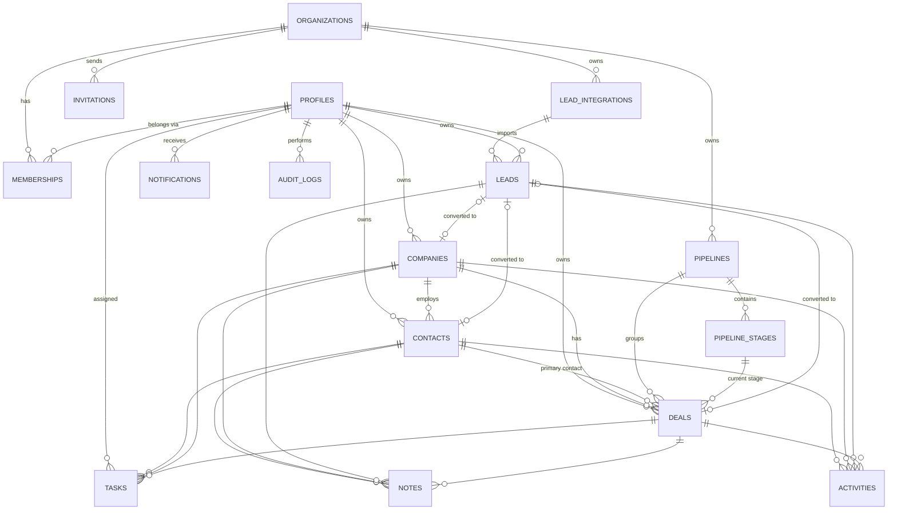

# NexaCRM — Architecture & Implementation Plan

> Status: all ten phases implemented, plus an **AI assistant** (phase 11), **social
> lead imports** (phase 12) and **organizations / multi-tenancy** (phase 13). This
> document was the plan; it has been updated where the implementation made a
> different (documented) choice, and to describe the code as it is now.

This document is the blueprint for NexaCRM. It covers the architecture, folder
structure, database schema, entity relationships, API surface, frontend pages and
the phased roadmap. Each phase is built, run, tested and verified before the next
one starts.

Guiding priority: **functionality > simplicity > clean code > polish > optimization.**

---

## 1. High-level architecture

```
┌─────────────────────────┐        ┌──────────────────────────┐
│  Next.js (TypeScript)   │  auth  │      Supabase Auth       │
│  - UI (shadcn/ui)       │◄──────►│  sign up / login / reset │
│  - Supabase JS client   │        │  email verification      │
│  - Axios + TanStack Q.  │        │  issues JWT access token │
└───────────┬─────────────┘        └────────────┬─────────────┘
            │ REST + "Authorization: Bearer <JWT>"│ JWKS (public keys)
            ▼                                     ▼
┌──────────────────────────────────────────────────────────────┐
│  FastAPI                                                     │
│  - verifies Supabase JWT (dependency)                        │
│  - loads/creates local profile                               │
│  - X-Organization-Id → membership + role; DB session scoped  │
│    to that organization (app/db/tenancy.py)                  │
│  - routers → services → SQLAlchemy models                    │
│  - /api/assistant/chat → LangGraph agent + LangChain tools   │──────► Google Gemini API
└───────────────────────────┬──────────────────────────────────┘        or local Ollama
                            ▼
                ┌──────────────────────┐
                │  PostgreSQL          │  ← all CRM data, Alembic migrations
                │  (local or Docker)   │
                └──────────────────────┘
```

### Request flow

1. The user signs in on the Next.js login page. The **Supabase JS client** talks
   directly to Supabase Auth and stores the session in cookies (`@supabase/ssr`).
2. `src/proxy.ts` (Next.js 16's replacement for `middleware.ts`) refreshes the
   session and redirects signed-out users to `/login`.
3. An **Axios interceptor** reads the current access token from Supabase and adds
   `Authorization: Bearer <token>` to every FastAPI request, plus
   `X-Organization-Id` with the active organization (remembered in
   `localStorage` by `src/lib/active-organization.ts`). Account-level calls opt
   out with `withoutOrganization`.
4. FastAPI's `get_authenticated_user` dependency verifies the JWT signature and
   expiry (Supabase JWKS for asymmetric keys, or the legacy HS256 secret) and
   checks `aud == "authenticated"`. Account-level endpoints (`/api/me`,
   `/api/organizations`, `/api/me/invitations`) need only this.
5. The `sub` claim (Supabase user UUID) is looked up in our `profiles` table. On
   the user's first request a profile is created automatically ("just-in-time
   provisioning"). A new profile belongs to **no organization** and can see
   no CRM data.
   CRM endpoints use `get_current_user`, which also requires an
   `X-Organization-Id` header (400 without one): it checks the user has a
   **membership** in that organization (404 if not, 403 if the membership is
   disabled), takes their **role from the membership**, and scopes the
   request's DB session to the organization (`app/db/tenancy.py`): every ORM
   query gets `WHERE organization_id = …` added automatically and new rows are
   stamped with it. With no organization selected, queries match nothing.
   These organization errors carry an `X-Organization-Error` response header,
   on which the frontend forgets the active organization and returns to
   `/organizations`.
   Public webhooks resolve the organization from the integration they hit.
6. Route handlers call **services** (business logic), which use **SQLAlchemy**
   models and write **audit logs / notifications** in the same DB transaction.

### Key decisions (and why)

| Decision | Reason |
|---|---|
| Supabase is used **only for auth**; CRM data lives in our own Postgres | Matches the spec (Postgres in Docker Compose), keeps SQLAlchemy/Alembic in full control of the schema. |
| **Multi-tenancy by `organization_id`** on every CRM table, enforced on the DB session (`app/db/tenancy.py`) | One database and one schema; isolation can't be forgotten in a single query because session events add the filter and stamp new rows. It fails closed: no organization → no rows. |
| Roles live on **memberships**, not profiles | One login can be Admin in one organization and Sales Rep in another. |
| Joining an organization only by **invitation** to a verified email | Signing up grants nothing; admins decide who gets in. |
| **Synchronous** SQLAlchemy 2.0 | Easier to read, debug and explain. FastAPI runs sync endpoints in a thread pool, which is plenty for this app. |
| Enums stored as `VARCHAR`, validated by Pydantic/Python `Enum` | Avoids painful Postgres native-enum migrations when a value is added. |
| UUID primary keys everywhere | Profiles already use Supabase's UUID; consistent IDs, no guessable sequential URLs. |
| Activities / notes / tasks link to records through **nullable foreign keys** (`contact_id`, `company_id`, `lead_id`, `deal_id`) | Real FK integrity, and one call can appear on both a contact's and a deal's timeline. |
| Notes are their own table; activities are calls/meetings/emails | Notes are editable text; activities are logged interactions with a time and duration. The timeline merges both, so to the user "Note" is simply the 4th activity type. |
| Task-due notifications are generated **lazily** when notifications are fetched | No background worker needed; deterministic and easy to test. |
| Notifications refresh via TanStack Query polling (every 60s) | No websockets or extra infrastructure. |
| Kanban uses native HTML5 drag-and-drop plus a "Move to stage" menu | No extra drag-and-drop library; menu keeps it usable on touch devices. |
| AI assistant tools call the **existing route functions** (`leads.create_lead`, `activities.create_activity`, …) | One code path for UI and chat: validation, permissions, audit entries and notifications can't drift apart. |
| The assistant is **stateless** on the server | The browser sends the whole conversation (with the records saved in earlier turns) on every message. No chat tables, no sessions to expire. |
| Chat model behind a small factory (`build_chat_model`), Gemini or Ollama | Switch providers with one env var; Gemini gets a fallback model for overload/quota errors; tests inject a scripted fake model. |

### Roles & authorization

Simple, table-driven rules, enforced in FastAPI dependencies/services (the UI
also hides actions a user can't perform, but the backend is the source of truth).
Roles are **per organization** (`memberships.role`); everything below applies
inside the organization the request is scoped to. Other organizations' records
are invisible to everyone.

| Capability | Admin | Manager | Sales Rep |
|---|:-:|:-:|:-:|
| View all of the organization's contacts, companies, leads, deals, tasks, activities | ✅ | ✅ | ✅ |
| Create records | ✅ | ✅ | ✅ (always owned by themselves) |
| Edit records | ✅ any | ✅ any | ✅ only records they own |
| Reassign owner | ✅ | ✅ | ❌ |
| Delete records | ✅ | ✅ | ❌ (except their own activities, notes and tasks) |
| Convert leads / move deals | ✅ | ✅ | ✅ own records |
| Sales-rep performance report | ✅ | ✅ | ❌ |
| Audit log | ✅ | ✅ | ❌ |
| Manage members (invite, change role, disable, remove), rename the organization, pipeline stages, lead sources | ✅ | ❌ | ❌ |

Any signed-in user can create a new organization (they become its Admin) and
accept invitations sent to their verified email. An admin can't change their own
role, disable or remove themselves, and an organization always keeps at least one
active admin.

"Everyone sees the book of business; reps can only change their own records" is
common for small sales teams and keeps queries simple.

---

## 2. Folder structure

```
nexa-crm/
├── docker-compose.yml            # frontend + backend + postgres (optional); reads a root .env (no template committed)
├── docker/postgres/init.sql      # creates nexa_crm_test
├── README.md
├── docs/
│   ├── ARCHITECTURE.md           # this file
│   ├── USER_GUIDE.md             # how to use every feature
│   └── purpose · ai · tech-stack · design · rules · production · cloud · contributing (.md)
├── backend/
│   ├── Dockerfile
│   ├── requirements.txt
│   ├── .env.example
│   ├── alembic.ini
│   ├── alembic/
│   │   ├── env.py
│   │   └── versions/
│   ├── app/
│   │   ├── main.py               # app factory, CORS, routers, error handlers
│   │   ├── core/
│   │   │   ├── config.py         # pydantic-settings (env vars)
│   │   │   ├── security.py       # Supabase JWT verification; Fernet encryption of integration tokens
│   │   │   └── exceptions.py     # NotFound / Forbidden → HTTP errors
│   │   ├── db/
│   │   │   ├── base.py           # DeclarativeBase + UUID / timestamp mixins
│   │   │   ├── session.py        # engine, SessionLocal, get_db
│   │   │   └── tenancy.py        # OrgScopedMixin + session events that scope every query to one organization
│   │   ├── models/               # one file per table group (organization.py: organizations, memberships, invitations)
│   │   ├── schemas/              # Pydantic request/response models
│   │   ├── services/             # business logic (lead conversion, lead import, Meta leads, reports…)
│   │   │   └── assistant/        # agent.py (LangGraph graph + system prompt), tools.py (LangChain tools),
│   │   │                         # llm.py (Gemini / Ollama), records.py (list filters), exports.py (files),
│   │   │                         # speech.py (Whisper voice input)
│   │   ├── api/
│   │   │   ├── router.py         # includes all feature routers under /api
│   │   │   └── routes/           # companies.py, contacts.py, leads.py, organizations.py, integrations.py, ...
│   │   ├── dependencies/
│   │   │   ├── auth.py           # get_authenticated_user, get_current_user (+ organization), require_roles(...)
│   │   │   └── pagination.py     # page / page_size / sort params
│   │   └── utils/query.py        # search_filter, apply_sort, paginate, get_or_404
│   ├── scripts/
│   │   └── seed.py               # demo data in a separate "Demo Organization"; --reset reseeds it, --clear deletes it
│   └── tests/
│       ├── conftest.py           # test DB + JWT factory
│       └── test_*.py
└── frontend/
    ├── Dockerfile
    ├── .env.example
    ├── components.json           # shadcn/ui config
    ├── scripts/generate-icons.mjs  # `npm run icons`: regenerates favicon / PWA icons from the logo mark
    └── src/
        ├── proxy.ts              # session refresh + route protection
        ├── app/
        │   ├── page.tsx          # public landing page (signed-in users are redirected to /dashboard)
        │   ├── (auth)/           # login, signup, forgot/reset password
        │   ├── (app)/            # authenticated shell (sidebar + topbar), wrapped in OrganizationGate
        │   ├── organizations/    # "Your organizations" picker (outside the shell)
        │   ├── auth/callback/    # Supabase email-link handler
        │   └── robots.ts · sitemap.ts · manifest.ts · opengraph-image.tsx · icon.svg  # SEO / PWA files
        ├── components/
        │   ├── ui/               # shadcn/ui primitives
        │   ├── layout/           # sidebar, topbar, theme toggle, user menu, page header, logo
        │   └── shared/           # data table, pagination, filters, badges,
        │                         # kanban, timeline, charts, confirm dialog
        ├── features/             # per-module components + hooks
        │   ├── contacts/         # contacts-view.tsx, contact-detail.tsx, contact-form-dialog.tsx, hooks.ts, …
        │   ├── companies/  leads/  deals/  tasks/  activities/
        │   ├── dashboard/  reports/  notifications/  settings/  auth/  landing/
        │   ├── organizations/    # organization gate, sidebar switcher, organizations page
        │   ├── integrations/     # Settings → Lead sources
        │   └── assistant/        # assistant-sheet.tsx (chat panel), hooks.ts, voice recorder
        ├── hooks/                # use-current-user, use-list-state, use-resource, use-mobile
        ├── lib/
        │   ├── supabase/         # browser, server and proxy clients + config
        │   ├── api-client.ts     # Axios instance + token / organization interceptor, getErrorMessage
        │   ├── active-organization.ts  # active organization id in localStorage, switch / leave helpers
        │   ├── site.ts           # product name, description, public URL (SEO metadata)
        │   └── utils.ts          # cn()
        ├── services/             # thin typed API functions per resource
        ├── types/index.ts        # shared TS types mirroring API schemas
        └── utils/format.ts       # Intl formatting (currency, dates)
```

The TanStack `QueryClient` and the `next-themes` `ThemeProvider` (light / dark /
system) are created in `src/app/providers.tsx`; `src/app/layout.tsx` also renders
Vercel Web Analytics (`@vercel/analytics`).

---

## 3. Database schema

All tables have `id UUID PK`, `created_at` and `updated_at` (`timestamptz`,
server defaults) unless noted. `owner_id` = the "assigned user".

**Tenant column.** Every CRM table below (companies, contacts, leads,
lead_integrations, pipelines, pipeline_stages, deals, activities, notes, tasks,
notifications, audit_logs) also has `organization_id` → organizations
(CASCADE), indexed, via `OrgScopedMixin`. It isn't repeated in each table.
Only `profiles`, `organizations`, `memberships` and `invitations` are global.

### profiles
Application-side user record (global, one per login). `id` equals the Supabase auth user id.

| Column | Type | Notes |
|---|---|---|
| id | UUID PK | = JWT `sub` |
| email | varchar, unique | |
| full_name | varchar | |
| is_active | bool | global kill switch for the whole account (403 everywhere); per-organization access is `memberships.status` |

There is no `role` column: the role comes from the membership of the
organization the request is scoped to (`Profile.role` is a per-request attribute).

### organizations
| Column | Type | Notes |
|---|---|---|
| name | varchar(100) | admins can rename it |
| created_by_id | FK → profiles (SET NULL) | |

### memberships
| Column | Type | Notes |
|---|---|---|
| organization_id | FK → organizations (CASCADE), indexed | unique together with `user_id` |
| user_id | FK → profiles (CASCADE), indexed | |
| role | varchar | `admin` \| `manager` \| `sales_rep` |
| status | varchar | `active` \| `disabled` (disabled members stay listed and keep their records, but get 403) |

### invitations
| Column | Type | Notes |
|---|---|---|
| organization_id | FK → organizations (CASCADE), indexed | |
| email | varchar, indexed | lowercased; re-inviting refreshes the open invitation |
| role | varchar | role given on acceptance |
| invited_by_id | FK → profiles (SET NULL) | |
| expires_at | timestamptz | 14 days after (re)sending |
| accepted_at | timestamptz | null while open |

`created_at` only (no `updated_at`).

### companies
| Column | Type | Notes |
|---|---|---|
| name | varchar, indexed | required |
| industry | varchar, indexed | |
| website, email, phone | varchar | |
| address, city, country | varchar/text | |
| employee_count | int | |
| owner_id | FK → profiles (SET NULL), indexed | |
| created_by_id | FK → profiles (SET NULL) | |

### contacts
| Column | Type | Notes |
|---|---|---|
| first_name, last_name | varchar | first required |
| email | varchar, indexed | |
| phone, job_title, website | varchar | |
| address, city, country | varchar/text | |
| status | varchar, indexed | `active` \| `customer` \| `inactive` |
| tags | `text[]` | filterable with `@>` |
| company_id | FK → companies (SET NULL), indexed | |
| owner_id, created_by_id | FK → profiles | |

### leads
| Column | Type | Notes |
|---|---|---|
| name, email, phone, company_name | varchar | name required |
| source | varchar, indexed | website, referral, advertisement, social_media, email, cold_call, other |
| status | varchar, indexed | new, contacted, qualified, unqualified, converted |
| score | int 0–100 | |
| owner_id, created_by_id | FK → profiles | |
| converted_at | timestamptz | |
| converted_contact_id / converted_company_id / converted_deal_id | FKs (SET NULL) | filled on conversion |
| social_platform | varchar, indexed | facebook, instagram, twitter, linkedin, tiktok, youtube, whatsapp, other |
| social_handle | varchar | @username or profile URL |
| external_id | varchar | the platform's lead id; unique per `(organization_id, social_platform, external_id)` (de-duplication within an organization) |
| integration_id | FK → lead_integrations (SET NULL) | which connection imported it |

### lead_integrations
| Column | Type | Notes |
|---|---|---|
| name, kind, platform | varchar | kind: `meta_lead_ads` or `webhook` |
| is_active | bool | paused integrations reject webhook calls |
| webhook_token | varchar, unique | secret part of `/api/integrations/webhooks/{token}` |
| meta_page_id, meta_page_name | varchar | Meta only |
| access_token_encrypted | text | Fernet-encrypted Page token (key from `INTEGRATIONS_SECRET`); never returned by the API |
| default_owner_id, default_score | FK → profiles, int | applied to imported leads |
| leads_imported, last_lead_at, last_synced_at, last_error | | status shown in Settings → Lead sources |
| created_by_id | FK → profiles (SET NULL) | |

### pipelines / pipeline_stages
| pipelines | | pipeline_stages | |
|---|---|---|---|
| name | varchar | pipeline_id | FK → pipelines (CASCADE) |
| is_default | bool | name | varchar |
| | | position | int (ordering) |
| | | probability | int 0–100 (default for deals) |
| | | stage_type | `open` \| `won` \| `lost` |

Default pipeline ("Sales Pipeline"): New (10%) → Contacted (20%) → Qualified (40%) →
Proposal (60%) → Negotiation (80%) → Won (100%) → Lost (0%). Each organization gets
its own, created together with the organization (`services/pipelines.create_default_pipeline`);
`get_default_pipeline` still creates it lazily if it's missing (e.g. data migrated from
before organizations existed).

### deals
| Column | Type | Notes |
|---|---|---|
| name | varchar | required |
| value | numeric(14,2) | |
| currency | char(3) | default `USD` |
| pipeline_id, stage_id | FKs, indexed | |
| status | varchar, indexed | `open` \| `won` \| `lost` — mirrors the stage type for simple reporting |
| probability | int 0–100 | defaults from stage |
| expected_close_date | date | |
| closed_at | timestamptz, indexed | set when moved to won/lost |
| company_id, contact_id | FKs (SET NULL) | |
| owner_id, created_by_id | FK → profiles | |
| description | text | |

### activities
| Column | Type | Notes |
|---|---|---|
| type | varchar | `call` \| `meeting` \| `email` |
| subject | varchar | |
| description | text | |
| occurred_at | timestamptz, indexed | |
| duration_minutes | int | optional |
| contact_id, company_id, lead_id, deal_id | nullable FKs (SET NULL) | at least one required (API validation) |
| owner_id | FK → profiles | who logged it |

### notes
| Column | Type | Notes |
|---|---|---|
| body | text | |
| contact_id, company_id, lead_id, deal_id | nullable FKs | at least one required |
| owner_id | FK → profiles (the author) | |

### tasks
| Column | Type | Notes |
|---|---|---|
| title | varchar | required |
| description | text | |
| due_date | date, indexed | |
| priority | varchar | low, medium, high, urgent |
| status | varchar, indexed | pending, in_progress, completed, cancelled |
| owner_id | FK → profiles, indexed | assigned user |
| created_by_id | FK → profiles (SET NULL) | |
| contact_id, company_id, deal_id | nullable FKs | |
| completed_at | timestamptz | |
| due_notified | bool | prevents duplicate "task due" notifications |

### notifications
| Column | Type | Notes |
|---|---|---|
| user_id | FK → profiles (CASCADE) | index `(user_id, is_read)` |
| type | varchar | lead_assigned, deal_assigned, task_assigned, task_due, deal_won, deal_lost |
| title, message | varchar/text | |
| entity_type, entity_id | varchar, UUID | for linking in the UI |
| is_read | bool | |
| created_at | timestamptz, indexed | no `updated_at` |

Notifications are per organization too: a user only sees the ones from the organization they're working in.

### audit_logs
| Column | Type | Notes |
|---|---|---|
| user_id | FK → profiles (SET NULL) | |
| action | varchar | e.g. `deal.created`, `deal.stage_changed`, `lead.converted` |
| entity_type, entity_id | varchar, UUID | index on both |
| details | JSONB | e.g. `{"from": "Proposal", "to": "Won"}` |
| created_at | timestamptz, indexed | no `updated_at` (append-only) |

---

## 4. Entity relationships

Every CRM entity below also belongs to one `ORGANIZATIONS` row (omitted from the
diagram to keep it readable).



### Lead conversion (single transaction)

`POST /api/leads/{id}/convert` with `{ create_deal: bool (default true), deal_name?, deal_value?, expected_close_date?, company_id? }`:

1. Reject if the lead is already `converted` (409).
2. **Company**: use `company_id` if given; else find an existing company by
   `company_name` (case-insensitive); else create one. Skipped if the lead has no company.
3. **Contact**: create from the lead's name (split into first/last), email, phone,
   linked to the company, same owner.
4. **Deal** (optional): create in the default pipeline's first stage.
5. Re-link the lead's activities and notes to the new contact (history carries over).
6. Mark the lead `converted`, set `converted_at` and the three `converted_*_id`s.
7. Write audit log `lead.converted`; return the created IDs.

---

## 5. API endpoints

All routes are under `/api`, require a valid Supabase JWT (except `/api/health`
and the two public integration webhooks), and return JSON. OpenAPI docs at `/docs`.

**Organization header.** Every CRM endpoint (everything below except Health,
Me, `GET/POST /api/organizations` and `/api/me/invitations…`) also needs
`X-Organization-Id: <organization id>`: 400 without it, 404 for an organization
you're not a member of, 403 if your membership is disabled. `GET/PATCH /api/me`
accept it optionally (`role` is null without one).

**List conventions** (contacts, companies, leads, deals, tasks, activities, notes, notifications, audit log):
`?page=1&page_size=20&search=…&sort_by=created_at&sort_order=desc&<filters>` →
`{ items, total, page, page_size, pages }`. `sort_by` is whitelisted per resource.

**Errors**: `{ "detail": "message" }` with 400/401/403/404/409/422 as appropriate;
the assistant adds 502 (the model failed), 503 (Gemini selected but no API key, or
voice input off) and 413 (voice recording over 10 MB).

| Area | Method & path | Notes |
|---|---|---|
| Health | `GET /api/health` | public |
| Me | `GET /api/me`, `PATCH /api/me` | current profile, with the role in the organization from the (optional) header; update name |
| Organizations | `GET /api/organizations` | organizations you belong to, with your role, membership status and active member count |
| | `POST /api/organizations` | create one: you become its admin and it gets the default pipeline |
| | `GET /api/organizations/current`, `PATCH /api/organizations/current` | the header's organization; rename is **admin** |
| Invitations | `GET/POST /api/invitations`, `DELETE /api/invitations/{id}` | **admin**: open invitations to the current organization; invite `{email, role}` (re-inviting refreshes it; 400 if already an active member); revoke |
| | `GET /api/me/invitations`, `POST /api/me/invitations/{id}/accept`, `POST …/{id}/decline` | invitations addressed to your verified email; no organization header. Accepting creates (or re-activates) your membership with the invited role |
| Users | `GET /api/users` | members of the current organization (role and active state from the membership), for "assign to" dropdowns |
| | `PATCH /api/users/{id}` | **admin**: `role`, `is_active` (enables/disables the membership, not the account) |
| | `DELETE /api/users/{id}` | **admin**: remove from the organization; their records stay |
| Companies | `GET/POST /api/companies`, `GET/PATCH/DELETE /api/companies/{id}` | filters: industry, country, owner_id; detail includes contact/deal counts |
| | `GET /api/companies/industries`, `GET /api/companies/options?search=` | distinct industries (filter dropdown); `{id, name}` options for comboboxes |
| Contacts | `GET/POST /api/contacts`, `GET/PATCH/DELETE /api/contacts/{id}` | filters: status, company_id, owner_id, tag |
| | `GET /api/contacts/tags`, `GET /api/contacts/options?search=&company_id=` | distinct tags; `{id, name}` options |
| Leads | `GET/POST /api/leads`, `GET/PATCH/DELETE /api/leads/{id}` | filters: status, source, social_platform, owner_id, min_score |
| | `POST /api/leads/{id}/convert` | Lead → Contact + Company + Deal |
| | `POST /api/leads/import` | `{csv_text, platform?, owner_id?, score?, dry_run?}` → leads (`dry_run` previews); the owner gets one notification |
| Lead sources | `GET /api/integrations/setup` | **admin**: whether the Meta webhook and token storage are configured on the server |
| | `GET/POST /api/integrations`, `PATCH/DELETE /api/integrations/{id}`, `POST …/{id}/rotate-token`, `POST …/{id}/sync` | **admin**; sync pulls a Meta Page's form leads, at most 2,000 new ones per call (`has_more: true` → sync again) |
| | `POST /api/integrations/webhooks/{token}` | **public**, secret URL; body = lead object, list, or `{leads: [...]}` (≤ 100) |
| | `GET/POST /api/integrations/meta/webhook` | **public**; Meta verify handshake / `X-Hub-Signature-256`-signed `leadgen` events. If several organizations connected the same Page, each gets its own copy of the lead |
| Pipelines | `GET /api/pipelines` | pipelines with ordered stages |
| | `POST /api/pipelines`, `PATCH /api/pipelines/stages/{id}` | **admin** |
| Deals | `GET/POST /api/deals`, `GET/PATCH/DELETE /api/deals/{id}` | filters: pipeline_id, stage_id, status, owner_id, company_id, contact_id, close_from, close_to |
| | `GET /api/deals/board?pipeline_id=&search=&owner_id=` | stages with their deals (Kanban) |
| | `PATCH /api/deals/{id}/stage` | move stage → status/probability/closed_at, audit, notifications |
| Activities | `GET/POST /api/activities`, `PATCH/DELETE /api/activities/{id}` | filters: type, owner_id, contact_id, company_id, lead_id, deal_id, date_from, date_to |
| Notes | `GET/POST /api/notes`, `PATCH/DELETE /api/notes/{id}` | filters: contact_id, company_id, lead_id, deal_id |
| Timeline | `GET /api/timeline?contact_id=…` (or company/lead/deal; `limit` ≤ 200, default 100) | activities + notes, newest first |
| Tasks | `GET/POST /api/tasks`, `GET/PATCH/DELETE /api/tasks/{id}` | filters: status, priority, owner_id, due_from, due_to, overdue, open_only, related ids |
| Dashboard | `GET /api/dashboard/summary` | KPI counts, deal value, recent activities, upcoming tasks, conversion rate |
| Reports | `GET /api/reports/lead-conversion` | all reports accept `start_date`, `end_date` |
| | `GET /api/reports/pipeline` | open deals count & value per stage |
| | `GET /api/reports/revenue` | won value per month |
| | `GET /api/reports/win-loss` | won vs lost counts & value per month |
| | `GET /api/reports/rep-performance` | **manager/admin** |
| | `GET /api/reports/lead-sources` | leads, conversions, rate per source |
| Notifications | `GET /api/notifications`, `GET /api/notifications/unread-count` | also generates due-task notifications lazily |
| | `PATCH /api/notifications/{id}/read`, `POST /api/notifications/read-all` | |
| Audit log | `GET /api/audit-logs` | **manager/admin**; filters: entity_type, entity_id, user_id, action, start_date, end_date |
| AI assistant | `POST /api/assistant/chat` | body `{ messages: [{role, content, records?, export_offer?, files? (names)}] }` (1–50 messages, the last from the user, ≤ 8,000 chars each) → `{ reply, records, files, export_offer }` |
| | `POST /api/assistant/export` | body `{ filters: {record_type, search?, created_by?, owner?, status?, source?, location?, created_from?, created_to?}, format: "xlsx" \| "docx" \| "pptx" \| "md" }` → `{ filename, format, mime_type, content_base64 }`; 400 for an unknown team member or filter value |
| | `POST /api/assistant/transcribe` | raw audio body (`audio/webm`, `audio/ogg` or `audio/mp4`, ≤ 10 MB) → `{ text }` (empty if no speech); 503 if voice input is off or the model can't load |

### What triggers notifications / audit logs

| Event | Notification | Audit action |
|---|---|---|
| Lead created/reassigned to someone else | `lead_assigned` → new owner | `lead.created` / `lead.updated` |
| Deal created/reassigned to someone else | `deal_assigned` → new owner | `deal.created` / `deal.updated` |
| Task created/reassigned to someone else | `task_assigned` → assignee | — |
| Deal moved to Won / Lost | `deal_won` / `deal_lost` → owner + the organization's active managers/admins (excluding the actor) | `deal.stage_changed` |
| Task due tomorrow, today or overdue | `task_due` → owner (once per task) | — |
| Lead converted | — | `lead.converted` |
| Leads imported (CSV, webhook, Meta) | `lead_assigned` → the owner: one per lead from webhooks/Meta, one summary per CSV import | `lead.imported` |
| Create / update / delete of a company, contact, lead or deal | — | `<entity>.created/updated/deleted` |
| Lead source created / changed / token rotated / synced / deleted | — | `integration.created/updated/token_rotated/synced/deleted` |
| Organization created / renamed | — | `organization.created` / `organization.renamed` |
| Member invited / invitation revoked / joined / role or access changed / removed | — | `member.invited` / `member.invitation_revoked` / `member.joined` / `member.updated` / `member.removed` |
| Anything saved by the AI assistant | same as the matching UI action | same as the matching UI action |

Activities, notes, tasks and pipeline-stage edits are not audited.

---

## 6. Frontend page structure

| Route | Page | Main components |
|---|---|---|
| `/` | Public landing page (signed-in users are redirected to `/dashboard`); JSON-LD structured data | LandingView |
| `/organizations` | "Your organizations": open one, accept/decline invitations, create an organization. Outside the app shell; `OrganizationGate` sends you here when no (active) organization is selected | OrganizationsView |
| `/login`, `/signup` | Supabase auth forms | RHF + Zod forms |
| `/forgot-password`, `/reset-password` | Supabase password reset flow | |
| `/auth/callback` | Route handler for email-confirmation / reset links | |
| `/dashboard` | KPI cards, pipeline & lead-source charts, recent activities, upcoming tasks | StatCard, charts, ActivityTimeline |
| `/contacts` | Searchable, filterable, sortable, paginated table; create/edit dialog | DataTable, Filters, Pagination |
| `/contacts/[id]` | Details, company, deals, tasks, **activity timeline**, notes | Timeline, NotesPanel |
| `/companies`, `/companies/[id]` | Table; detail with contacts, deals, timeline | |
| `/leads`, `/leads/[id]` | Table with status/source/platform filters and **Import** (CSV) dialog; detail with **Convert lead** dialog | ConvertLeadDialog, ImportLeadsDialog |
| `/deals`, `/deals/[id]` | List view of deals; detail with stage selector, timeline, tasks | |
| `/pipeline` | **Kanban board** — drag deals between stages; column totals | KanbanBoard |
| `/activities` | Chronological feed with type/date filters; log activity dialog | |
| `/tasks` | Open / Overdue / Completed / All views, "My tasks" / "Team" switch, priority filter and sort | |
| `/reports` | Date-range picker + six report cards/charts | |
| `/notifications` | Full list, mark read / mark all read (bell in the topbar too) | |
| `/settings` | Profile · Organization (admin: rename) · Users & roles (admin: invite people, roles, active switch, remove) · Pipeline stages (admin) · Lead sources (admin) · Audit log (manager/admin) | |
| *(every page)* | **AI Assistant** button, theme toggle (light/dark/system) and notification bell in the top bar; organization switcher at the top of the sidebar | AssistantSheet, ThemeToggle, OrganizationSwitcher |

Every page under `(app)` is marked `noindex`; only `/`, `/login` and `/signup` are
meant for search engines (`robots.ts`, `sitemap.ts`).

Create/edit forms open in dialogs/sheets instead of separate pages, which keeps
the route count low and the UX fast.

**Data layer**: `services/*.ts` (typed Axios calls) → `features/*/hooks.ts`
(TanStack Query hooks built with `createResourceHooks`: queries with
pagination/filter keys, mutations that invalidate related queries and show
toasts). The assistant's chat mutation invalidates the whole query cache when
it saved anything, because it may have touched any list, detail or timeline.
Switching organizations does a full page load (`enterOrganization`), so no cached
data from the previous organization survives.

---

## 6b. AI assistant

Files: `backend/app/services/assistant/{agent,tools,llm,records,exports,speech}.py`, `app/schemas/assistant.py`,
`app/api/routes/assistant.py`; frontend `features/assistant/`, `services/assistant.ts`.

```
POST /api/assistant/chat ──▶ chat(db, user, messages)
                                 │  system prompt (user's name and role, today's date, the next 7 days) + conversation
                                 ▼
             START ──▶ agent ──(tool calls?)── yes ──▶ tools ──┐
                         ▲          │                          │
                         │          no ──▶ END (reply text)    │
                         └─────────────────────────────────────┘
```

- **agent** node: the chat model from `build_chat_model` (`llm.py`) with the tools bound.
  `LLM_PROVIDER=gemini` → `ChatGoogleGenerativeAI` (`GEMINI_MODEL`, 40s timeout, one retry,
  then `GEMINI_FALLBACK_MODEL` on rate-limit/API/timeout/connection errors);
  `LLM_PROVIDER=ollama` → `ChatOllama` (`OLLAMA_MODEL`, the model's default temperature because
  Qwen3 loops at temperature 0). Thinking follows the model: `qwen3:4b` is
  Qwen3-4B-Thinking-2507, which can't stop thinking (it reasons in the reply instead), so when
  Ollama reports the `thinking` capability it's turned on (reasoning kept out of the reply,
  replies capped at 6,144 tokens, 10k context); otherwise off (1,024 tokens, 8k context). Earlier
  steps' reasoning is stripped before each model call so it isn't replayed into the context.
  A full message takes ~10 min on a 4 GB GTX 1650; `qwen3:4b-instruct` is the fast alternative.
- **tools** node: LangGraph `ToolNode` with twelve tools: the list/export tools described below, and these. Two read: `search_records` (leads,
  contacts and companies by name/email/phone, with phone and email, so "what's X's number?"
  takes one call) and `get_record_details` (one record with its timeline, open tasks, deals and,
  for a company, its contacts). Seven write: `create_lead`, `update_lead`, `create_company`,
  `create_contact`, `log_activity`, `add_note`, `create_task`. Each write tool builds the normal Pydantic `*Create`/`*Update` schema and calls the route function, so
  permissions (a rep can't update another rep's lead), audit entries and notifications are
  identical to the UI. Each save is committed immediately.
- The DB session and user travel in the LangGraph run config (`configurable`), which the model
  never sees. Tool calls run one at a time (`max_concurrency=1`) because they share one session.
- Tool errors (validation, 403, 404…) are rolled back and returned to the model as
  `{"error": …}`, so it can fix its arguments or explain the problem.
- Each tool returns `(content, artifact)`: JSON for the model, and a `SavedRecord`
  (`type`, `action`, `id`, `label`, `link_type`, `link_id`) that the chat shows as a link.
  Activities and notes link to the record they were logged on.
- At most 10 model rounds per message. If the limit is hit, or the model fails after
  something was saved, the reply still lists what was saved. A model failure with nothing
  saved returns 502 with a readable reason (daily quota used up, rate limit, timeout,
  Ollama not reachable or model not pulled).
- The system prompt's rules: search before creating (no duplicates), new prospects become
  **leads**, every described call/email/meeting is logged, promised follow-ups become tasks,
  never invent names or contact details, ask one clarifying question at a time. It also states
  the user's role and what that role may change, so the model can explain a refusal.
- The chat runs inside the organization from the request's `X-Organization-Id`, like any CRM
  endpoint, so it only ever reads and writes that organization's records.
- Not available through chat today: creating or changing deals, lead conversion, deletes, and reports.

**Lists and files.** `list_records` lists leads, contacts, companies, deals or tasks by filters
(`search`, `created_by`, `owner` — team members by name, email or "me" — `status`, lead `source`,
`location` — city, country or address of companies and contacts — `created_from`/`created_to`; `services/assistant/records.py`). The model sees the count and the
first 15 rows; the response carries an `export_offer` (the filters, count and label). The prompt
has the model end a list answer with "Would you like this as an Excel file?" and a longer
write-up with an offer of Word (PowerPoint when the user mentions a presentation). On "yes" it
calls `export_records` (same filters) or `export_document` (sections
it wrote: heading, paragraphs, bullets, optional table). Markdown only when asked for.
`services/assistant/exports.py` renders one small document model to `.xlsx` (openpyxl; CRM text is
never stored as a formula; up to 5,000 rows), `.docx` (python-docx; 1,000 rows), `.pptx` (python-pptx;
12 rows and 6 columns per slide, 120 rows max) or `.md` (5,000 rows). Files come back inline as base64 (`files` in the response), so the
stateless server stores nothing. The chat also shows Excel / Word / PowerPoint buttons under a
list, which call `POST /api/assistant/export` directly: no model call, no quota used. Earlier
offers and file names go back to the model in the history, so "yes, export it" reuses the filters.

**Voice input.** The mic button in the chat box records a clip in the browser (`MediaRecorder`,
Opus in WebM, or MP4 on Safari; `features/assistant/use-voice-recorder.ts`, max 2 minutes) and
posts it to `POST /api/assistant/transcribe`. `speech.py` runs open-source Whisper with
faster-whisper (CTranslate2; PyAV decodes the clip) on the API server, so audio never leaves your
own infrastructure and nothing is stored. The model loads once, on first use. `vad_filter` skips
silence (where Whisper tends to invent text), and the names of the 20 most recently updated
contacts, leads and companies each are passed as `hotwords`, so unusual names come out spelled
the way the CRM has them ("Khadse", not "Kodsi") and the assistant can find the record. Enter
while recording sends the text straight to the chat; ✓ puts it in the box to edit first; Esc
cancels. Transcription is the only voice step: the reply is still text.

---

## 7. Implementation roadmap

Every phase ends with: run the app → run tests → fix errors → verify in the
browser → short summary of what was built.

| Phase | Scope | Verification |
|---|---|---|
| **1. Setup + Supabase auth** | Git init; backend restructure (config, DB session, Alembic, `profiles` model); JWT verification + `get_current_user` / `require_roles`; `GET /api/me`, users endpoints; Postgres via Docker Compose; frontend deps (Supabase SSR, TanStack Query, RHF, shadcn/ui); login/signup/reset pages; `proxy.ts`; app shell with sidebar; Axios interceptor | pytest auth tests (401 missing/invalid token, JIT profile, 403 role check); sign up → login → dashboard shell shows name & role |
| **2. Companies + Contacts** | Models, migrations, schemas, CRUD APIs, ownership rules; reusable DataTable, Pagination, Filters, form dialog; list + detail pages | CRUD + permission tests; manual CRUD in UI |
| **3. Leads + conversion** | Leads CRUD; conversion service & dialog | Conversion tests (creates/links company, contact, deal; 409 on re-convert) |
| **4. Deals + pipeline** | Pipelines/stages (default pipeline created lazily on first use); deals CRUD; board endpoint; stage moves; Kanban UI | Stage-move tests (status, closed_at, probability) |
| **5. Activities, tasks, notes** | Three modules + timeline endpoint + timeline component on detail pages | CRUD tests, timeline ordering |
| **6. Dashboard + reports** | Summary + 6 report endpoints; charts (shadcn charts / Recharts) | Report query tests on known data |
| **7. Notifications + audit log** | Notification + audit services wired into existing actions; bell + page; audit log in settings | Tests that actions create the right rows |
| **8. Search / filter / pagination pass** | Make every list consistent (search, filters, sorting, URL-synced state) | Query tests; UI check |
| **9. Tests, error handling, UI polish** | Global error handlers, loading/empty/error states, toasts, responsive layout, seed script | Full pytest run; `next build` + lint clean |
| **10. Docker + docs + cleanup** | Dockerfiles, full `docker-compose.yml`, `.env.example`s, README (setup, Supabase, migrations, seed, API, testing, future work) | `docker compose config` validates; a full image build and run hasn't been done yet (see `cloud.md`) |
| **11. AI assistant** | LangGraph agent + LangChain tools over the existing routes; Gemini/Ollama selection with a fallback model; chat panel in the top bar; list exports (Excel/Word/PowerPoint/Markdown); Whisper voice input | `tests/test_assistant.py` (scripted fake model), `test_assistant_exports.py`, `test_assistant_voice.py` (fake Whisper); manual chats against the test database |
| **12. Social lead imports** | `lead_integrations` table; webhook + Meta Lead Ads endpoints; CSV import; Settings → Lead sources; platform badge and filter on leads | `tests/test_integrations.py` |
| **13. Organizations (multi-tenancy)** | `organizations`, `memberships`, `invitations`; `organization_id` on every CRM table with session-level scoping (`app/db/tenancy.py`); roles moved to memberships; organization picker, switcher, invitations and member management in the UI; migration moves existing data into one "My Organization" | `tests/test_organizations.py` (isolation across organizations, invitations, admin rules) |

Also shipped outside the numbered phases: dark mode (`next-themes` toggle), a public
landing page with SEO metadata (robots, sitemap, Open Graph image, web manifest),
Vercel Web Analytics, and a deployment on Vercel + Render (see `cloud.md`).

**Later, separate phase — "Scalability & Production Optimization"**: Redis
caching, background jobs, query optimization, rate limiting, structured logging,
monitoring, CI/CD. None of it is part of the initial build.

---

## Dependencies to add

**Backend**: `psycopg[binary]` (Postgres driver), `pydantic-settings`,
`email-validator`, `PyJWT[crypto]` (JWT + JWKS verification), `pytest`, `httpx`.
AI assistant: `langgraph`, `langchain`, `langchain-google-genai`, `langchain-ollama`;
file exports `openpyxl`, `python-docx`, `python-pptx`; voice input `faster-whisper`
(+ `av`). Integration token encryption uses `cryptography` (Fernet).
Full list with versions: `tech-stack.md`.

**Frontend**: `@supabase/supabase-js`, `@supabase/ssr`, `@tanstack/react-query`,
`react-hook-form`, `@hookform/resolvers`, shadcn/ui (brings Radix primitives via
`radix-ui`, `class-variance-authority`, and the `cn` package instead of
`clsx` + `tailwind-merge`), `recharts` (via shadcn charts), `sonner` (toasts, via shadcn),
`next-themes` (dark mode), `@vercel/analytics`.

## Environment variables

| File | Variable | Purpose |
|---|---|---|
| `backend/.env` | `DATABASE_URL` | `postgresql+psycopg://…` (code default: the Compose DB on `localhost:5433`) |
| | `SUPABASE_URL` | **required**; used to fetch JWKS public keys |
| | `SUPABASE_JWT_SECRET` | must be **set** (settings has no default), but may be empty; a value is only needed for projects on legacy HS256 keys |
| | `CORS_ORIGINS` | comma-separated; trailing slashes are stripped. Default `http://localhost:3000,https://nexa-crm-eta.vercel.app` |
| | `LLM_PROVIDER` | `gemini` (default) or `ollama` |
| | `GEMINI_API_KEY`, `GEMINI_MODEL`, `GEMINI_FALLBACK_MODEL` | Gemini settings (model defaults `gemini-3.5-flash-lite` / `gemini-3.5-flash`) |
| | `OLLAMA_BASE_URL`, `OLLAMA_MODEL` | Ollama settings (defaults `http://localhost:11434` / `qwen3:4b`) |
| | `INTEGRATIONS_SECRET` | Social lead imports: any long random string; encrypts stored Meta Page access tokens. Required for Meta Lead Ads |
| | `META_APP_SECRET` / `META_VERIFY_TOKEN` | Meta app secret (verifies `leadgen` webhook signatures) and the verify token you type into the Meta webhook setup |
| | `META_GRAPH_VERSION` | Graph API version, default `v26.0` |
| | `WHISPER_MODEL`, `WHISPER_DEVICE`, `WHISPER_COMPUTE_TYPE`, `WHISPER_LANGUAGE` | voice input (defaults `base` / `cpu` / `int8` / `en`; empty model turns it off) |
| `frontend/.env.local` (or `.env`) | `NEXT_PUBLIC_SUPABASE_URL` | Supabase project URL |
| | `NEXT_PUBLIC_SUPABASE_PUBLISHABLE_KEY` | publishable (anon) key — safe for the browser |
| | `NEXT_PUBLIC_API_URL` | e.g. `http://localhost:8000/api` |
| | `NEXT_PUBLIC_SITE_URL` | public origin for canonical URLs, sitemap and social images (default `http://localhost:3000`) |

No service-role key is needed anywhere, so no secret ever reaches the browser.
The Gemini API key stays in `backend/.env`; the browser only talks to FastAPI.
